# Debezium PostgreSQL CDC → Kafka

## Описание


Учебный проект  **Change Data Capture (CDC)**: изменения из **PostgreSQL** с помощью **Debezium Connector** передаются в **Apache Kafka**, читаются Python-консьюмером, а работа Kafka Connect отслеживается через **Prometheus** и **Grafana**.


Выполнено:

- PostgreSQL, Kafka, Kafka Connect, Prometheus и Grafana разворачиваются через Docker Compose.
- Debezium PostgreSQL Connector отслеживает изменения **только** в таблицах `users` и `orders`.
- Python-консьюмер читает CDC-события из Kafka и выводит их в терминал.
- JMX Exporter отдаёт метрики Kafka Connect и Debezium, Prometheus их собирает.
- В Grafana автоматически создаются datasource и дашборд с графиками.

---

# Архитектура

```text
                         ┌────────────────────────────────────────┐
┌──────────────┐  WAL    │ Kafka Connect (контейнер kafka-connect)│
│  PostgreSQL  │ ──────► │  ┌──────────────────────────────┐      │
│ users,orders │ logical │  │ Debezium PostgreSQL Connector│      │
│ (pgoutput)   │ replic. │  └──────────────┬───────────────┘      │
└──────────────┘         │                 │                      │
                         │  JMX Exporter (java-agent) :9404       │
                         └────────┬────────┼──────────────────────┘
                                  │        │ CDC-события
                          /metrics│        ▼
                                  │  ┌───────────┐     ┌───────────┐
                                  │  │   Kafka   │◄────│ ZooKeeper │
                                  │  └─────┬─────┘     └───────────┘
                                  │        │ postgres.public.users
                                  │        │ postgres.public.orders
                                  ▼        ▼
                          ┌────────────┐  ┌──────────────────────┐
                          │ Prometheus │  │ consumer/consumer.py │
                          └─────┬──────┘  └──────────────────────┘
                                ▼
                          ┌────────────┐
                          │  Grafana   │
                          └────────────┘
```

# Структура проекта

```text
.
├── docker-compose.yaml                 # все сервисы решения
├── README.md
├── .gitignore
├── requirements.txt                    # зависимости consumer.py
│
├── connector
│   └── postgres-connector.json         # конфигурация Debezium Connector
│
├── docs
│   └── images
│       └── image.png                   # скриншоты выполнения работы        
│
├── kafka-connect
│   └── Dockerfile                      # debezium/connect + JMX Prometheus Exporter
│
├── postgres
│   ├── init.sql                        # создание таблиц и начальные данные
│   └── test-data.sql                   # данные для проверки CDC (INSERT/UPDATE/DELETE)
│
├── consumer
│   └── consumer.py                     # чтение событий из Kafka
│
└── monitoring
    ├── prometheus.yml                  # конфигурация Prometheus
    ├── jmx-exporter
    │   └── kafka-connect.yml           # правила преобразования JMX → Prometheus
    └── grafana
        ├── provisioning
        │   ├── datasources/prometheus.yml
        │   └── dashboards/dashboards.yml
        └── dashboards
            └── kafka-connect-debezium.json
```

---

# Запуск через Docker Compose

## 1. Сборка и запуск контейнеров

```bash
docker compose up -d --build
```

При первом запуске собирается образ `kafka-connect-jmx:2.6`: в него скачивается `jmx_prometheus_javaagent`.

Проверить состояние контейнеров:

```bash
docker compose ps
```

Должны работать: `zookeeper`, `kafka` (healthy), `postgres` (healthy), `kafka-connect`, `prometheus`, `grafana`.

Kafka Connect стартует только после того, как Kafka и PostgreSQL пройдут healthcheck. После этого ему нужно ещё около 20–40 секунд.

## 2. Проверка Kafka Connect

```bash
curl http://localhost:8083/
```

Ожидаемый ответ:

```json
{"version":"...","commit":"...","kafka_cluster_id":"..."}
```
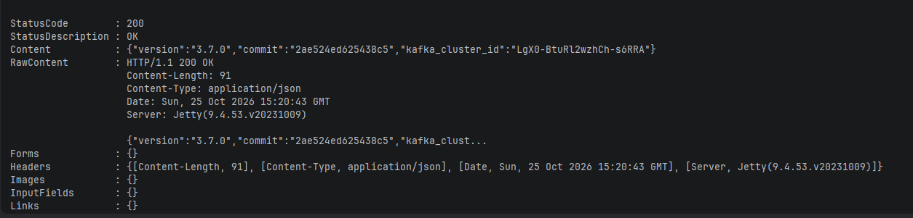

Проверить, что плагин Debezium установлен:

```bash
curl http://localhost:8083/connector-plugins
```

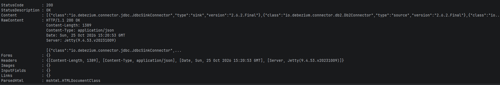
## Остановка

```bash
docker compose down -v
```

Флаг `-v` удаляет данные, при следующем запуске `init.sql` выполнится заново.

---

# PostgreSQL

При первом запуске контейнера скрипт `postgres/init.sql` создаёт в базе `appdb` таблицы и добавляет тестовые данные из задания: 4 пользователя и 5 заказов.

```sql
CREATE TABLE users (
    id SERIAL PRIMARY KEY,
    name VARCHAR(100),
    email VARCHAR(100),
    created_at TIMESTAMP DEFAULT CURRENT_TIMESTAMP
);

CREATE TABLE orders (
    id SERIAL PRIMARY KEY,
    user_id INT REFERENCES users(id),
    product_name VARCHAR(100),
    quantity INT,
    order_date TIMESTAMP DEFAULT CURRENT_TIMESTAMP
);
```

---

# Настройки Debezium Connector

Файл `connector/postgres-connector.json`:

```json
{
  "name": "postgres-connector",
  "config": {
    "connector.class": "io.debezium.connector.postgresql.PostgresConnector",
    "tasks.max": "1",
    "database.hostname": "postgres",
    "database.port": "5432",
    "database.user": "postgres",
    "database.password": "postgres",
    "database.dbname": "appdb",
    "topic.prefix": "postgres",
    "plugin.name": "pgoutput",
    "slot.name": "debezium_slot",
    "publication.name": "dbz_publication",
    "publication.autocreate.mode": "filtered",
    "table.include.list": "public.users,public.orders",
    "snapshot.mode": "initial"
  }
}
```

| Параметр | Значение | Описание |
|---|---|---|
| `name` | `postgres-connector` | Имя коннектора в Kafka Connect |
| `connector.class` | `io.debezium.connector.postgresql.PostgresConnector` | Класс Debezium-коннектора для PostgreSQL |
| `tasks.max` | `1` | Число задач. PostgreSQL-коннектор всегда работает в одной задаче, потому что читает один слот репликации |
| `database.hostname` / `database.port` | `postgres` / `5432` | Адрес PostgreSQL внутри docker-сети |
| `database.user` / `database.password` | `postgres` / `postgres` | Учётные данные. Пользователю нужны права `REPLICATION` и право создавать публикацию (у `postgres` они есть) |
| `database.dbname` | `appdb` | База данных-источник |
| `topic.prefix` | `postgres` | Префикс топиков. Имя топика строится как `<prefix>.<schema>.<table>`: `postgres.public.users`, `postgres.public.orders` |
| `plugin.name` | `pgoutput` | Встроенный в PostgreSQL 10+ плагин логического декодирования, дополнительные расширения не нужны |
| `slot.name` | `debezium_slot` | Слот логической репликации. PostgreSQL хранит WAL, пока Debezium его не прочитает |
| `publication.name` | `dbz_publication` | Имя публикации PostgreSQL |
| `publication.autocreate.mode` | `filtered` | Публикация создаётся только для таблиц из `table.include.list`, а не `FOR ALL TABLES` |
| `table.include.list` | `public.users,public.orders` | **Отслеживаются только таблицы `users` и `orders`** |
| `snapshot.mode` | `initial` | При первом запуске делается snapshot текущих данных (события с `op = r`), затем коннектор читает поток изменений |

Конвертеры по умолчанию в образе `debezium/connect` — `JsonConverter` со `schemas.enable=true`. Поэтому каждое сообщение имеет вид `{"schema": {...}, "payload": {...}}`. В `payload` лежат поля `before`, `after`, `source`, `op` (`r`, `c`, `u`, `d`) и `ts_ms`.

## Создание коннектора

bash:

```bash
curl -X POST http://localhost:8083/connectors \
  -H "Content-Type: application/json" \
  -d @connector/postgres-connector.json
```

PowerShell:

```powershell
curl.exe -X POST http://localhost:8083/connectors -H "Content-Type: application/json" -d "@connector/postgres-connector.json"
```
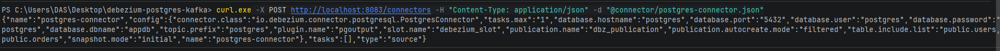
---

# Пошаговая проверка работоспособности

## Шаг 1. Статус коннектора

```bash
curl http://localhost:8083/connectors/postgres-connector/status
```

Ожидаемый результат: и коннектор, и задача в статусе `RUNNING`.

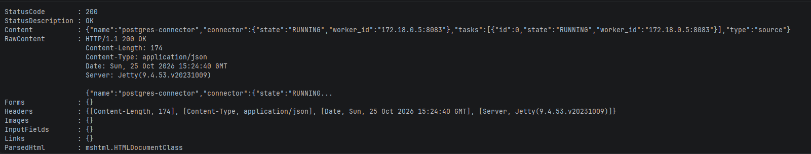

Если задача в статусе `FAILED`, в поле `trace` будет стек ошибки. Также полезно посмотреть логи: `docker logs kafka-connect`.

## Шаг 2. Только нужные таблицы

Список топиков:

```bash
docker exec kafka kafka-topics --bootstrap-server kafka:29092 --list
```

Должны появиться `postgres.public.users` и `postgres.public.orders`, топиков для других таблиц быть не должно. Также видны служебные `connect_configs`, `connect_offsets`, `connect_statuses`.
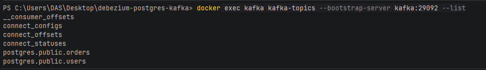


Проверка публикации в PostgreSQL: в ней должны быть только две таблицы.

```bash
docker exec postgres psql -U postgres -d appdb -c "SELECT * FROM pg_publication_tables;"
```
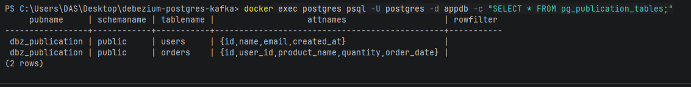

## Шаг 3. Чтение данных из Kafka (Python)

```bash
pip install -r requirements.txt
python consumer/consumer.py
```


Консьюмер читает топики с начала (`auto_offset_reset=earliest`). Сначала он выведет данные snapshot'а: 4 пользователя и 5 заказов с `op = r`. Для каждого события выводятся топик, ключ, тип операции, таблица и состояния строки `before`/`after`. Поля `TIMESTAMP` Debezium передаёт как число микросекунд, консьюмер переводит их в дату.

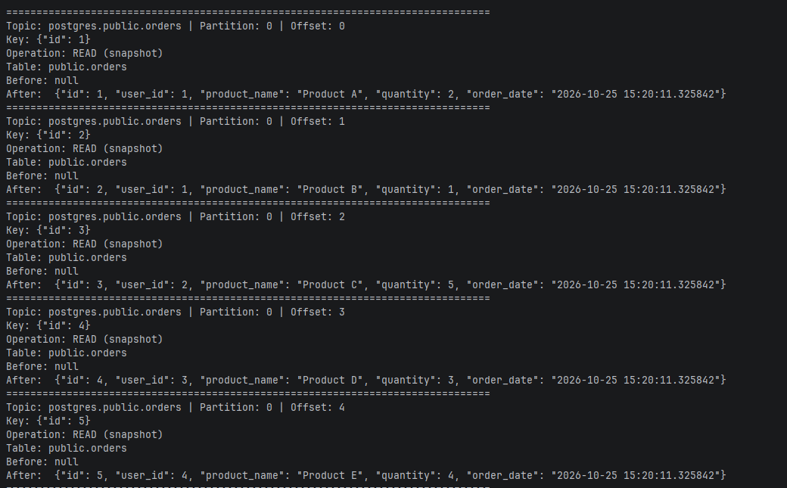

Консьюмер оставляется запущенным, следующий шаг выполняется в другом терминале.

## Шаг 4. Изменение данных в PostgreSQL

Загрузить `postgres/test-data.sql`: в нём INSERT, UPDATE и DELETE.

bash:

```bash
docker exec -i postgres psql -U postgres -d appdb < postgres/test-data.sql
```

PowerShell:

```powershell
Get-Content postgres/test-data.sql | docker exec -i postgres psql -U postgres -d appdb
```
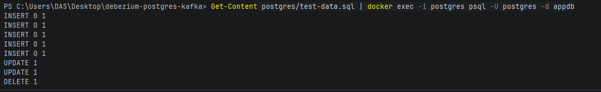
В терминале консьюмера сразу появятся события. Ниже фрагмент вывода после загрузки `test-data.sql` (UPDATE пользователя John Doe, DELETE заказа Mouse):

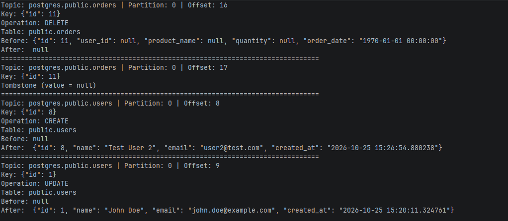

> `before` для UPDATE пустой, а для DELETE содержит только первичный ключ. Это из-за `REPLICA IDENTITY DEFAULT`. Чтобы получать строку целиком, выполните `ALTER TABLE users REPLICA IDENTITY FULL;`.

Изменения можно вносить и вручную, события появятся в консьюмере так же:

```bash
docker exec -it postgres psql -U postgres -d appdb
```

```sql
INSERT INTO users (name, email) VALUES ('Test User', 'test@example.com');
INSERT INTO orders (user_id, product_name, quantity) VALUES (1, 'Test Product', 10);
UPDATE users SET email = 'new@example.com' WHERE name = 'Test User';
```

## Шаг 5. Метрики в Prometheus

1. Метрики экспортера доступны напрямую:

   ```bash
   curl http://localhost:9404/metrics
   ```

   В выводе должны быть строки вида `kafka_connect_connector_status{connector="postgres-connector",status="running",} 1.0` и `debezium_metrics_connected{context="streaming",...} 1.0`.
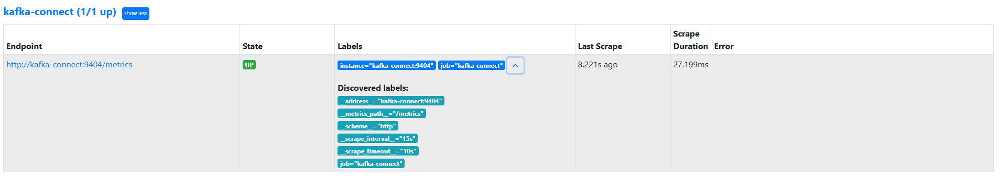
2. Необходимо открыть http://localhost:9090 → **Status → Targets**. Цель `kafka-connect` (`kafka-connect:9404`) должна быть в состоянии **UP**.
3. Во вкладке **Graph** выполните, например, `kafka_connect_source_task_source_record_write_total`.
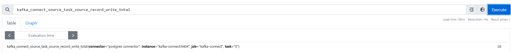
## Шаг 6. Дашборд в Grafana

Необходимо открыть http://localhost:3000 (логин `admin`, пароль `admin`) → **Dashboards → Kafka Connect / Debezium CDC**. Datasource и дашборд создаются автоматически, ничего настраивать вручную не нужно.

После загрузки `test-data.sql` на графиках «Скорость передачи записей» и «CDC-события по типам операций» видны всплески.
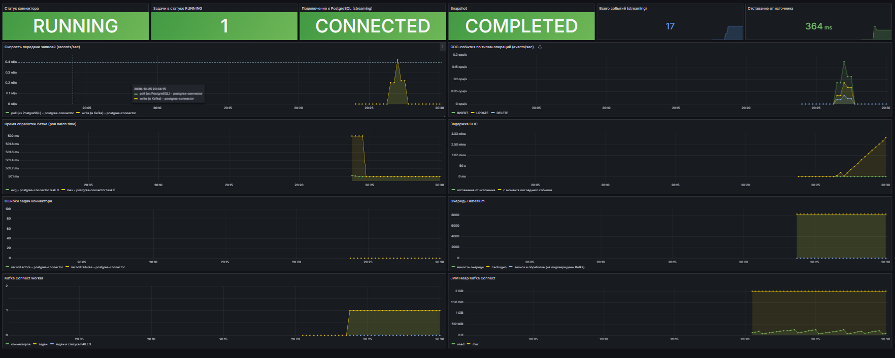
---

# Мониторинг

## Как собираются метрики

1. Kafka Connect и Debezium публикуют метрики как JMX MBean'ы:
   - `kafka.connect:type=connector-metrics,connector=…` — статус коннектора;
   - `kafka.connect:type=connector-task-metrics,…` / `source-task-metrics` / `task-error-metrics` — метрики задачи;
   - `kafka.connect:type=connect-worker-metrics` — метрики воркера;
   - `debezium.postgres:type=connector-metrics,context=snapshot|streaming,server=postgres` — метрики Debezium.
2. `jmx_prometheus_javaagent` подключается к JVM Kafka Connect через `KAFKA_OPTS=-javaagent:...=9404:/kafka/jmx/kafka-connect.yml` и отдаёт метрики по HTTP на порту `9404`.
3. Правила в `monitoring/jmx-exporter/kafka-connect.yml` задают имена метрик Prometheus. Строковый статус (`running`, `failed`, …) превращается в метку `status` со значением `1`.
4. Prometheus собирает метрики с `kafka-connect:9404` каждые 15 секунд.
5. Grafana строит графики по Prometheus.

## Основные метрики

| Метрика Prometheus | Что показывает |
|---|---|
| `kafka_connect_connector_status{status="running"}` | Коннектор работает (1) |
| `kafka_connect_task_status{status="running\|failed\|..."}` | Статус задач коннектора |
| `kafka_connect_source_task_source_record_poll_total` | Сколько записей задача получила от Debezium (из PostgreSQL) |
| `kafka_connect_source_task_source_record_write_total` | Сколько записей записано в Kafka |
| `kafka_connect_source_task_source_record_active_count` | Записи, отправленные, но ещё не подтверждённые Kafka |
| `kafka_connect_source_task_poll_batch_avg_time_ms` / `_max_time_ms` | Время обработки батча |
| `kafka_connect_task_error_total_record_errors` / `_failures` | Ошибки обработки записей |
| `kafka_connect_worker_connector_count` / `_task_count` | Число коннекторов и задач на воркере |
| `debezium_metrics_connected{context="streaming"}` | Есть ли подключение Debezium к PostgreSQL |
| `debezium_metrics_snapshotcompleted{context="snapshot"}` | Начальный snapshot завершён |
| `debezium_metrics_totalnumberofeventsseen` | Сколько всего событий обработал Debezium |
| `debezium_metrics_totalnumberof{create,update,delete}eventsseen` | События по типам операций |
| `debezium_metrics_millisecondsbehindsource` | Отставание: время между изменением в БД и его обработкой |
| `debezium_metrics_millisecondssincelastevent` | Сколько прошло с последнего события |
| `debezium_metrics_queueremainingcapacity` / `queuetotalcapacity` | Заполненность внутренней очереди Debezium |

## Дашборд Grafana «Kafka Connect / Debezium CDC»

Файл: `monitoring/grafana/dashboards/kafka-connect-debezium.json`.

**Работоспособность (верхний ряд):** статус коннектора, число задач в статусе RUNNING, подключение к PostgreSQL, статус snapshot, общее число событий, текущее отставание.

**Передача данных:**

- **Скорость передачи записей** — `rate(kafka_connect_source_task_source_record_poll_total[1m])` и `rate(kafka_connect_source_task_source_record_write_total[1m])`;
- **CDC-события по типам операций** — INSERT / UPDATE / DELETE в секунду;
- **Время обработки батча** — avg и max;
- **Задержка CDC** — `MilliSecondsBehindSource` и `MilliSecondsSinceLastEvent`.

**Диагностика:**

- **Ошибки задач коннектора** — ошибки, сбои записей и упавшие задачи;
- **Очередь Debezium** — ёмкость и свободное место в очереди, записи в обработке;
- **Kafka Connect worker** — число коннекторов и задач, упавшие задачи;
- **JVM Heap Kafka Connect** — использование памяти.

---

# Результат

- Брокер Kafka (с ZooKeeper) с двумя listener'ами: для docker-сети и для хоста.
- PostgreSQL с логической репликацией и таблицами `users` и `orders`.
- Kafka Connect с Debezium Connector, который отслеживает только `users` и `orders`. Конфигурация лежит в `connector/postgres-connector.json`.
- Python-консьюмер, который выводит CDC-события в терминал.
- Метрики Kafka Connect и Debezium в Prometheus (через JMX Exporter).
- Дашборд Grafana с графиками передачи данных и работоспособности коннектора.
